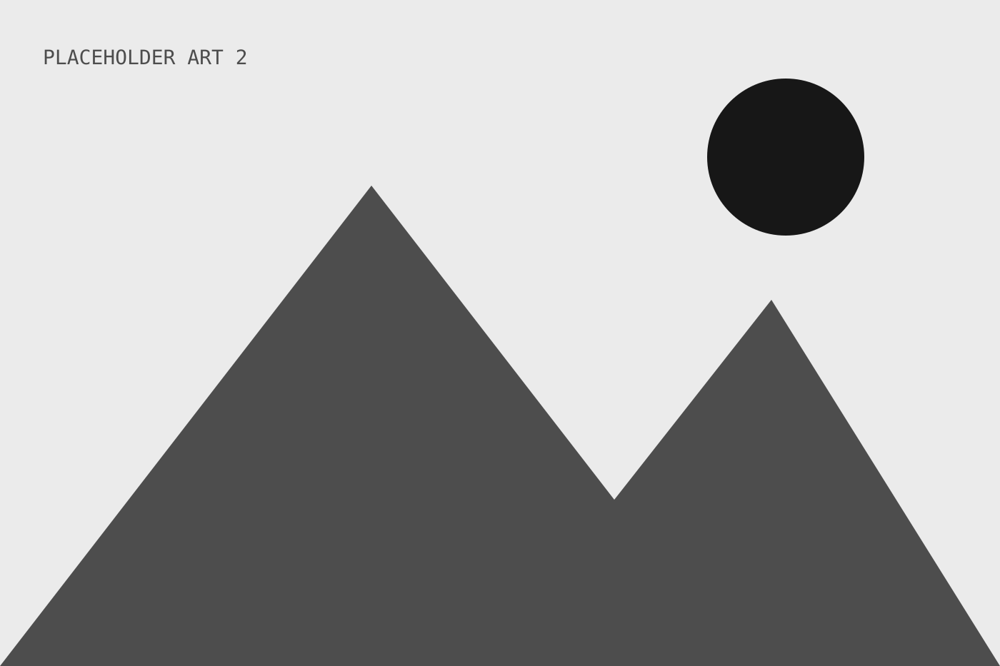

{/* Every heading level, for reviewing the hierarchy. */}
## Placeholder section heading one (H2)

This is a placeholder paragraph for the article body. It gives the page enough text to show the reading measure, line spacing and rhythm without adding finished copy.

### Placeholder subheading (H3)

This is a second placeholder paragraph with [a placeholder link](/proof) in it. Replace it with owner-written copy when the article is ready, keeping the same paragraph structure for the layout review.

#### Placeholder subheading (H4)

This is a third placeholder paragraph to show how the article continues down the page and how the section spacing feels in context.

##### Placeholder subheading (H5)

This is a placeholder paragraph for the article body. It gives the page enough text to show the reading measure, line spacing and rhythm without adding finished copy.

###### Placeholder subheading (H6)

This is a second placeholder paragraph with [a placeholder link](/proof) in it. Replace it with owner-written copy when the article is ready, keeping the same paragraph structure for the layout review.

This is a third placeholder paragraph to show how the article continues down the page and how the section spacing feels in context.

## Placeholder section heading two

This is a placeholder paragraph for the article body. It gives the page enough text to show the reading measure, line spacing and rhythm without adding finished copy.

This is a second placeholder paragraph with [a placeholder link](/proof) in it. Replace it with owner-written copy when the article is ready, keeping the same paragraph structure for the layout review.

This is a third placeholder paragraph to show how the article continues down the page and how the section spacing feels in context.

## Placeholder section heading three

This is a placeholder paragraph for the article body. It gives the page enough text to show the reading measure, line spacing and rhythm without adding finished copy.

This is a second placeholder paragraph with [a placeholder link](/proof) in it. Replace it with owner-written copy when the article is ready, keeping the same paragraph structure for the layout review.

This is a third placeholder paragraph to show how the article continues down the page and how the section spacing feels in context.

## Placeholder section heading four that runs much longer than the others

This is a placeholder paragraph for the article body. It gives the page enough text to show the reading measure, line spacing and rhythm without adding finished copy.

This is a second placeholder paragraph with [a placeholder link](/proof) in it. Replace it with owner-written copy when the article is ready, keeping the same paragraph structure for the layout review.

This is a third placeholder paragraph to show how the article continues down the page and how the section spacing feels in context.

## Placeholder section heading five

This is a placeholder paragraph for the article body. It gives the page enough text to show the reading measure, line spacing and rhythm without adding finished copy.

This is a second placeholder paragraph with [a placeholder link](/proof) in it. Replace it with owner-written copy when the article is ready, keeping the same paragraph structure for the layout review.

This is a third placeholder paragraph to show how the article continues down the page and how the section spacing feels in context.
